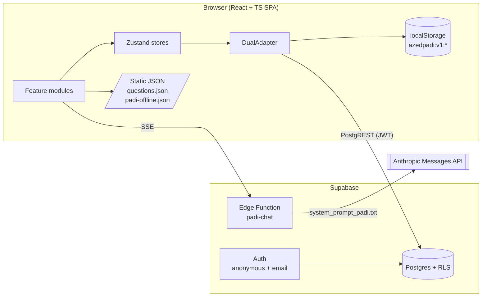

# AZed Padi: Architecture

> **Unofficial AZ-900 Prep Tool.** Not affiliated with, endorsed by, or sponsored by Microsoft. Questions are original. No Microsoft or Azure logos appear anywhere in the product.

Built for the Power Learn Project Vibe Coding Hackathon (#1MillionDevs). Source of truth: the AZ-900 Microsoft Azure Fundamentals study notes and the hackathon brief.

---

## 1. Requirements

**Functional**

| # | Requirement | Track |
|---|---|---|
| F1 | 50 original scenario questions, randomized question order, shuffled options, instant per-option feedback | 1 |
| F2 | Study plan generated from `days_left` (1–30), `daily_hours`, and weak domains | 3 |
| F3 | AI Study Buddy "Padi" explains any AZ-900 concept with an African analogy in English, Nigerian Pidgin, or Swahili | 4 |
| F4 | Readiness score weighted by official exam domain weights | 5 |
| F5 | Full demo works with zero login and zero backend (`localStorage`) | all |

**Non-functional**

| Constraint | Target |
|---|---|
| First interaction | Quiz playable in under 2 s on a cold load, no network call required |
| Persistence | Local write completes synchronously; remote write is async and retried |
| AI latency | First token under 2 s; hard cap 700 output tokens per reply |
| Security | The browser never holds an LLM key. Every table has Row Level Security |
| Compliance | Unofficial banner on every route. No exam dumps. No Microsoft marks |

**Scale (hackathon cohort)**: 1,000 learners, 20 quiz attempts each, 10 Padi calls each per day at peak.
Quiz writes: 20,000 rows total, ~1 KB each = 20 MB. Padi: 10,000 calls/day = ~0.12 req/s average, ~2 req/s burst. One Supabase project and one Edge Function carry this without a cache or queue.

---

## 2. System Context



Three runtime paths:

1. **Content path** (questions, offline analogies): static JSON bundled with the app. Never hits a server.
2. **Data path** (attempts, plans, saved analogies): `DualAdapter` writes `localStorage` first, then Supabase when available.
3. **AI path** (Padi): browser → Edge Function → Anthropic. The function holds the key, injects the system prompt, filters the stream, and returns clean text plus a metadata event.

---

## 3. Component Hierarchy

```
<App>
├─ <DisclaimerBanner />                 // "Unofficial AZ-900 Prep Tool", sticky, non-dismissible
├─ <PersistenceProvider adapter={DualAdapter}>
│  └─ <SessionProvider>                 // guest id or Supabase user, language, exam_date
│     └─ <AppShell>
│        ├─ <TopNav />                  // Quiz · Planner · Padi · Readiness
│        ├─ <Routes>
│        │  ├─ /quiz
│        │  │  └─ <QuizPage>
│        │  │     ├─ <QuizSetup />            // mode: full | domain | replay
│        │  │     ├─ <QuestionCard />         // scenario + 4 shuffled <OptionButton />
│        │  │     ├─ <FeedbackPanel />        // why right, why each wrong, "Ask Padi" button
│        │  │     └─ <QuizSummary />          // per-domain score → saves attempt
│        │  ├─ /planner
│        │  │  └─ <PlannerPage>
│        │  │     ├─ <PlannerForm />          // exam date, hours/day, weak-domain override
│        │  │     ├─ <TierBadge />            // last_stand | sprint | focused | full_coverage
│        │  │     └─ <DayTimeline />          // blocks deep-link into /quiz and /padi
│        │  ├─ /padi
│        │  │  └─ <PadiPage>
│        │  │     ├─ <LanguageToggle />       // en | pcm | sw
│        │  │     ├─ <JargonChips />          // IaaS vs PaaS, ZRS vs GZRS, ExpressRoute vs VPN...
│        │  │     ├─ <ChatThread />           // streams <answer> text only
│        │  │     ├─ <AnalogyCard />          // mapping table + "where it breaks"
│        │  │     └─ <SavedAnalogies />       // reads saved_padi_analogies
│        │  └─ /readiness
│        │     └─ <ReadinessPage>
│        │        ├─ <ReadinessDial />        // 0–100, band label
│        │        ├─ <DomainBars />           // accuracy + exam weight per domain
│        │        ├─ <WeakQuestionList />     // latest-incorrect IDs → "Replay"
│        │        └─ <AttemptHistory />
│        └─ <Footer />                  // disclaimer + "Based on the public AZ-900 skills outline"
```

---

## 4. State Flow

**Stores** (Zustand; each store reads and writes through the adapter, never through `localStorage` directly):

| Store | Holds | Persisted |
|---|---|---|
| `useSessionStore` | `userId`, `displayName`, `language`, `examDate`, `dailyHours` | profile |
| `useQuizStore` | `draft` (in-progress run), `attempts[]` | attempts (on completion only) |
| `usePlanStore` | `activePlan` | study_plans |
| `usePadiStore` | `thread[]`, `streaming`, `lastMeta` | saved analogies only |
| `selectReadiness` | derived selector over `attempts[]` | none |

**Quiz state machine**

```
idle ──start(mode)──▶ in_progress ──answer(optionId)──▶ reviewing ──next()──▶ in_progress
                          │                                  │
                          └────────── quit() ────────────────┴──finish()──▶ completed
                                                                             │
                                          adapter.saveAttempt(attempt) ◀─────┘
```

- `draft` lives in `localStorage` only (`azedpadi:v1:draft`). A refresh resumes the run.
- An attempt row is written once, on `completed`, with the IDs actually answered. Quitting early saves a partial attempt.
- `saveAttempt` sends a client-generated UUID. Retries are idempotent (`ON CONFLICT (id) DO NOTHING`).

**Cross-module flow**

```
Quiz completed ─▶ attempts[] changes ─▶ selectReadiness recomputes ─▶ Readiness dial updates
                                      └▶ Planner "Regenerate" uses new weak domains
FeedbackPanel "Ask Padi" ─▶ /padi?concept=<skillRef>&lang=<language> ─▶ auto-sends first message
AnalogyCard "Save" (enabled only if meta.verified === true) ─▶ adapter.saveAnalogy()
```

---

## 5. Question Bank

50 questions, split to mirror the official weights. IDs are stable and map to domains by range.

| Domain key | Official weight | Question IDs | Count | Share of 50 |
|---|---|---|---|---|
| `cloud_concepts` | 25–30% | 1–13 | 13 | 26% |
| `architecture_services` | 35–40% | 14–33 | 20 | 40% |
| `management_governance` | 30–35% | 34–50 | 17 | 34% |

```ts
type OptionId = 'a' | 'b' | 'c' | 'd';

interface Question {
  id: number;                       // 1..50, immutable
  domain: 'cloud_concepts' | 'architecture_services' | 'management_governance';
  skillRef: string;                 // exact bullet from the public AZ-900 skills outline
  scenario: string;                 // original; 2–4 sentences; ends with a decision
  options: { id: OptionId; text: string; whyNot?: string }[];  // 4 options
  correct: OptionId;
  explanation: string;              // why the correct option wins; names the trigger keyword
  difficulty: 1 | 2 | 3;
}
```

**Shuffle spec**

- Question order: Fisher–Yates seeded with `attemptId`. The same seed reproduces the same run.
- Option order: Fisher–Yates per question, seeded with `attemptId + ':' + question.id`.
- Feedback keys on `OptionId`, never on array index, so `whyNot` text always follows its option.
- Stored answer: `{ q, pick: OptionId, ok, ms }`.

---

## 6. Readiness Formula

Weights use the midpoint of each official range, normalized to sum to 1.

```
m_d  = (weight_min_d + weight_max_d) / 2        → cloud 27.5 · architecture 37.5 · management 32.5
W_d  = m_d / Σ m                                → 0.2821 · 0.3846 · 0.3333       (Σ m = 97.5)

N_d  = questions in domain d                    → 13 · 20 · 17
M_d  = distinct questions in d whose LATEST answer is correct
A_d  = M_d / N_d                                → mastery per domain; unseen questions count as 0

R    = 100 × Σ_d ( W_d × A_d )                  → readiness, 0–100
```

Latest answer wins. A question answered wrong in attempt 1 and right in attempt 3 counts as mastered. Unseen questions count as unmastered, so a learner cannot reach a high score by answering 5 easy questions.

**Bands**

| Band | Rule |
|---|---|
| Not ready | R < 50 |
| Building | 50 ≤ R < 65 |
| Close | 65 ≤ R < 80, or R ≥ 80 with any `A_d` < 0.70 |
| Exam-ready | R ≥ 80 and every `A_d` ≥ 0.70 |

The domain floor exists because the exam weights are ranges. A 27.5% domain can be 30% on exam day.

**Worked example.** `M = (10, 12, 9)`.

```
A = (10/13, 12/20, 9/17) = (0.7692, 0.6000, 0.5294)
R = 100 × (0.2821×0.7692 + 0.3846×0.6000 + 0.3333×0.5294) = 62.4
Band: Building. Weakest: management_governance (52.9%).
```

**Canonical implementation** (mirrored by `public.readiness_by_domain()` in `supabase_schema.sql`; add a unit test asserting both return 62.4 for the example):

```ts
export const DOMAINS = {
  cloud_concepts:         { min: 25, max: 30, n: 13 },
  architecture_services:  { min: 35, max: 40, n: 20 },
  management_governance:  { min: 30, max: 35, n: 17 },
} as const;

export function readiness(latestCorrect: Map<number, boolean>) {
  const mids = Object.values(DOMAINS).map(d => (d.min + d.max) / 2);
  const sum = mids.reduce((a, b) => a + b, 0);
  const rows = (Object.keys(DOMAINS) as (keyof typeof DOMAINS)[]).map((key, i) => {
    const mastered = [...latestCorrect].filter(([q, ok]) => ok && domainOf(q) === key).length;
    const accuracy = mastered / DOMAINS[key].n;
    const weight = mids[i] / sum;
    return { key, mastered, accuracy, weight, contribution: 100 * weight * accuracy };
  });
  const score = Math.round(rows.reduce((a, r) => a + r.contribution, 0) * 10) / 10;
  return { score, rows };
}
```

---

## 7. Study Planner Algorithm

**Inputs**: `exam_date`, `daily_hours` (0.5–12), `A_d` from section 6. `days_left = clamp(daysBetween(today, exam_date), 1, 30)`.

**Tier by days left**

| Tier | Days left | Learn / Drill / Review | Rule |
|---|---|---|---|
| `last_stand` | 1–3 | 10 / 60 / 30 | Drill only high-frequency confusables. No new topics on the final day |
| `sprint` | 4–7 | 25 / 50 / 25 | One full-domain pass, then weak-domain drilling |
| `focused` | 8–14 | 35 / 40 / 25 | Two passes; mock on day `T-1` |
| `full_coverage` | 15–30 | 45 / 35 / 20 | Three passes; one mock per week plus day `T-1` |

*Learn* = Padi sessions on a skill. *Drill* = quiz in a domain. *Review* = replay of latest-incorrect questions and saved analogies.

**Hour allocation**

```
H        = days_left × daily_hours
H_eve    = min(2, 0.5 × daily_hours)            // final day: light review only
H_mock   = 1 hour per mock                      // 50 questions, 60-minute timer
H_alloc  = H − H_eve − H_mock × mocks

p_d      = W_d × (1 − A_d + 0.15)               // 0.15 floor: no domain drops to zero
s_d      = p_d / Σ p
hours_d  = H_alloc × s_d                        // rounded to 15-minute blocks, largest remainder
```

**Worked example.** 5 days, 3 h/day, `A = (0.769, 0.600, 0.529)`, tier `sprint`, 1 mock.

```
H = 15 · H_eve = 1.5 · H_mock = 1 · H_alloc = 12.5
s = (0.204, 0.402, 0.393)
hours = cloud 2.55 · architecture 5.03 · management 4.92
```

A learner with no attempts has `A_d = 0` for all domains, so allocation tracks the official weights.

**Plan JSON** (stored in `study_plans.plan`):

```ts
interface Plan {
  version: 1;
  tier: 'last_stand' | 'sprint' | 'focused' | 'full_coverage';
  days: {
    index: number; date: string; minutes: number;
    blocks: {
      type: 'learn' | 'drill' | 'review' | 'mock' | 'eve';
      domain?: string; minutes: number; skillRefs?: string[];
      action: { route: '/quiz' | '/padi'; params: Record<string, string> };
    }[];
  }[];
}
```

---

## 8. Padi AI Path

**Request**

```
POST /functions/v1/padi-chat
Authorization: Bearer <user JWT, anonymous allowed>
{ "messages": [{ "role": "user", "content": "..." }],   // last 6 turns, each ≤ 1,500 chars
  "language": "en" | "pcm" | "sw",
  "context": { "daysLeft": 5, "weakDomains": ["management_governance"], "displayName": "Nuel" } }
```

**Edge Function steps**

1. Validate JWT, payload size, and `language`.
2. Build the system prompt: `system_prompt_padi.txt` bundled at deploy time, with `{{LANGUAGE}}`, `{{DAYS_LEFT}}`, `{{WEAK_DOMAINS}}`, `{{DISPLAY_NAME}}` substituted after validation: `language` and `weakDomains` checked against enums, `daysLeft` cast to an integer 1–30, `displayName` stripped to letters, digits, space, `.`, `-`, `_` (max 30 chars). Chat text is passed only in `messages`, never interpolated into the system prompt.
3. Call the Anthropic Messages API with `stream: true`, `max_tokens: 700`, `temperature: 0.3`, model from env `PADI_MODEL` (default `claude-sonnet-5-5`).
4. **Stream filter.** The model emits `<scratchpad>…</scratchpad><answer>…</answer><meta>{…}</meta>`. The function discards everything before `<answer>`, forwards text until `</answer>` as `event: delta`, then parses `<meta>` and sends `event: meta`. The scratchpad never reaches the browser.
5. If `<answer>` never appears within 1,200 tokens, send `event: error` and the client falls back to offline mode.

**Meta contract** (drives the "Save analogy" button and the `saved_padi_analogies` row; non-analogy replies send `{"kind":"other"}` and show no Save button; the client drops `kind` before insert):

```json
{ "kind": "analogy", "concept": "Availability Zones", "azure_service": "Azure Availability Zones",
  "domain": "architecture_services", "skill_ref": "Describe Azure regions, region pairs, and sovereign regions",
  "language": "en", "verified": true,
  "verifier_flags": { "facts_matched": 3, "facts_not_in_sheet": 0, "conflicts_resolved": 0, "analogy_revisions": 0 } }
```

**Offline fallback.** If the function is unreachable, `PadiPage` switches to `padi-offline.json`: 20 analogy cards (7 cloud concepts, 7 architecture, 6 governance) generated with the same prompt, then hand-checked against the fact sheet. Chips still work; free-text input is disabled with a visible "Padi is offline" state. The demo never shows a dead screen.

---

## 9. Dual-Persistence Adapter

```ts
export interface PersistenceAdapter {
  getProfile(): Promise<Profile | null>;
  saveProfile(p: Profile): Promise<void>;
  saveAttempt(a: QuizAttempt): Promise<void>;        // a.id is a client UUID
  listAttempts(): Promise<QuizAttempt[]>;
  saveActivePlan(p: StudyPlan): Promise<void>;
  getActivePlan(): Promise<StudyPlan | null>;
  saveAnalogy(a: SavedAnalogy): Promise<void>;
  listAnalogies(): Promise<SavedAnalogy[]>;
  deleteAnalogy(id: string): Promise<void>;
  resetAll(): Promise<void>;
}
```

Three implementations:

| Class | Role |
|---|---|
| `LocalAdapter` | Reads and writes `localStorage` under `azedpadi:v1:{profile,attempts,plan,analogies,draft,outbox}`. Wraps every `setItem` in try/catch (quota). Caps analogies at 200 |
| `SupabaseAdapter` | PostgREST through `@supabase/supabase-js`. Uses the user JWT; RLS does the authorization |
| `DualAdapter` | Composes the two. Picks mode at boot and on every failure |

**Mode selection**

```
if (!VITE_SUPABASE_URL || !VITE_SUPABASE_ANON_KEY)          → local-only
else if (signInAnonymously() or existing session fails)     → local-only
else                                                        → dual
Any 401 / 403 / 5xx / network error at runtime              → degrade to local-only; keep outbox
navigator 'online' event or 60 s timer                      → flush outbox
```

**Write path (dual mode)**

```
1. LocalAdapter.write(record)                  // synchronous-feeling, UI updates now
2. outbox.push({ table, op, record })          // persisted in localStorage
3. flush(): for each outbox item → SupabaseAdapter upsert → on success remove from outbox
```

**Read path**: local first for instant paint, then remote refresh merged into local.

**Conflict rules**

| Table | Strategy |
|---|---|
| `quiz_attempts` | Append-only. Union by `id`. `ON CONFLICT (id) DO NOTHING` |
| `saved_padi_analogies` | Union by `id`. Delete wins if the row is absent remotely |
| `profiles`, `study_plans` | Last-write-wins on `updated_at` |

**Guest → account migration.** On first sign-in with email, read all local records and upsert them with their existing UUIDs. Because IDs are client-generated, a retry after a crash never duplicates a row.

---

## 10. Data Access Contract

No custom REST server. PostgREST (Supabase) plus one Edge Function.

| Operation | Call | Auth |
|---|---|---|
| Read profile | `GET /rest/v1/profiles?id=eq.<uid>` | JWT, RLS |
| Save attempt | `POST /rest/v1/quiz_attempts` (`Prefer: resolution=ignore-duplicates`) | JWT, RLS |
| Latest mastery per question | `GET /rest/v1/v_question_mastery` | JWT, RLS |
| Readiness by domain | `POST /rest/v1/rpc/readiness_by_domain` | JWT, RLS |
| Save plan | `POST /rest/v1/study_plans` (trigger deactivates the previous active plan) | JWT, RLS |
| Save analogy | `POST /rest/v1/saved_padi_analogies` (policy requires `verified = true`) | JWT, RLS |
| Ask Padi | `POST /functions/v1/padi-chat` (SSE) | JWT |

Counts per domain on `quiz_attempts` are derived by a trigger from the submitted ID arrays. A client cannot submit inflated scores.

---

## 11. Content Truth Table (enforced in questions, Padi prompt, and offline cards)

| Topic | Rule |
|---|---|
| Identity | **Microsoft Entra ID.** "Azure AD" and "Azure Active Directory" appear only as a historical-name note |
| Cost estimation | **The TCO Calculator is retired.** Use the Azure Pricing Calculator to estimate cost and Microsoft Cost Management to analyze actual spend |
| Storage tiers | Hot (frequent) · **Cool: ≥ 30 days** · **Cold: ≥ 90 days** · **Archive: ≥ 180 days**, blob-level only |
| LRS | 3 copies in one datacenter · **≥ 11 nines** (99.999999999%) |
| ZRS | 3 availability zones, synchronous · **≥ 12 nines** |
| GRS / GZRS | Secondary region, asynchronous · **≥ 16 nines** |
| RA-GRS / RA-GZRS | Same replication plus read access to the secondary |
| Availability Zones | Minimum **3** separate zones in every AZ-enabled region |
| Region pairs | Same geography, **≥ 300 miles** apart |
| Hybrid networking | Site-to-site VPN: encrypted, over the public internet · ExpressRoute: dedicated private connection, not over the internet |
| IaC | ARM templates (JSON) and **Bicep** (declarative, more concise, compiles to ARM) |
| Governance | Azure Policy (rules) · resource locks (prevent delete/change) · Microsoft Purview (data governance) · Service Trust Portal (compliance docs) |
| Hybrid and multicloud management | **Azure Arc** |
| AI-assisted ops | **Copilot in Azure**: assists; humans validate and approve |
| Agentic AI | An application pattern built from Azure AI capabilities, not a compute service category |
| Zero Trust | Verify explicitly · least privilege access · assume breach |
| Defense in depth | Physical → identity and access → perimeter → network → compute → application → data |

---

## 12. African Analogy Bank (seed set for Padi and `padi-offline.json`)

Each analogy maps 1:1 to a service. Padi must also state where the analogy breaks.

| Azure concept | Analogy | Mapping |
|---|---|---|
| Availability Zones | A bank with branches in Victoria Island, Ikeja, and Lekki, each on its own power grid | Branch = zone · separate grid = independent power, cooling, networking · Lagos = region |
| ExpressRoute vs Site-to-Site VPN | Private railway line to the port vs an armored bullion van on a public highway | Railway = dedicated, off-internet link · armored van = encrypted tunnel over the internet |
| LRS → ZRS → GZRS | Safe in one vault → three vaults in one city → three vaults plus a copy in Abuja | Vault = datacenter or zone · second city = paired region |
| IaaS / PaaS / SaaS | Build your own shop / rent a stall in Balogun Market / buy from an online store | Customer manages less at each step |
| Resource group / subscription / management group | Stall / market block / market union | Scope hierarchy for RBAC and policy inheritance |
| Resource lock | Padlock on the generator house, even for the manager | Blocks delete or change regardless of RBAC role |
| Autoscale (VM scale sets) | Danfo conductors adding buses at rush hour | Horizontal scaling, identical instances |
| Entra ID + MFA | Staff ID card plus a fingerprint at the gate | Authentication with two factors |
| Azure Policy | Estate bylaws that reject a non-compliant build at the gate | Enforce or audit configuration rules |
| Cost Management + budgets | Prepaid electricity meter with a low-credit alert | Track spend, alert on thresholds |
| Defense in depth | Compound wall, gate, guard, door, safe | Layered protection; one breach does not expose the data |
| Archive tier | Old tax records in a warehouse in Ibadan | Cheapest to store, slow to retrieve (rehydration) |

---

## 13. Security and Compliance Checklist

- [ ] `DisclaimerBanner` renders on every route; footer repeats it
- [ ] No Microsoft or Azure logo in assets, favicon, OG image, or README
- [ ] 50 questions are original; none copied from any exam source
- [ ] `skillRef` on every question matches the public skills outline
- [ ] RLS enabled on all five tables; `anon` role has no table grants except `exam_domains` read
- [ ] Anthropic key only in Edge Function secrets
- [ ] System prompt receives only validated variables (enum-checked, integer-cast, or character-stripped); chat text stays in `messages`
- [ ] Anonymous sign-in enabled; email sign-in optional
- [ ] `localStorage` holds no secrets, only learner progress

---

## 14. Bottlenecks and Trade-offs

| Decision | Gain | Cost |
|---|---|---|
| Local-first writes | Demo works offline; no login friction | Dual code path; conflict rules to test |
| Attempt written only on completion | Small table, simple RLS | Mid-quiz state lives only on-device |
| Mastery = latest answer | Readiness rises as the learner improves | A lucky guess counts; 4 options give 25% guess odds |
| Arrays of question IDs in `quiz_attempts` | One row per run; trivial sync | Per-question analytics need `unnest` (views provided) |
| Hidden scratchpad in one call | One round trip; verifier cost stays server-side | ~300 extra output tokens per reply |
| Offline analogy cards | Demo survives a dead network | 20 cards cover a fraction of the syllabus |
| No DB-backed rate limiter | Faster to ship | Abuse protection relies on `max_tokens` cap, payload cap, and provider spend limit. Add a counter RPC after the hackathon |

**What breaks first at 10× load**: Edge Function concurrency and LLM spend, not Postgres. Mitigation order: response caching for chip-based questions (key = concept + language), then a per-user limiter, then a smaller model for chip queries.

---

## 15. Build Order (window closes Friday 23 Oct, 6:00 PM EAT)

| Slot | Deliverable | Cut line |
|---|---|---|
| Wed 21 | Schema applied · question bank 1–50 · quiz flow with shuffle and feedback · `LocalAdapter` | Must ship |
| Thu 22 AM | Readiness tracker · planner · `DualAdapter` + outbox | Must ship |
| Thu 22 PM | `padi-chat` Edge Function · stream filter · offline cards · Save analogy | Must ship |
| Fri 23 AM | Pidgin and Swahili checks · README with architecture diagram · demo script | Must ship |
| Fri 23 12:00–15:00 | Canva deck from the organizer template · screen-recorded demo | Must ship |
| Fri 23 15:00–17:00 | Submit with buffer; freeze `main` | Hard stop 17:00 |

**Judging map**

| Criterion | Where it is earned |
|---|---|
| Learning Value (25%) | Sections 5, 6, 11: accurate content, domain-weighted readiness |
| Prompt Engineering (20%) | Section 8 and `system_prompt_padi.txt`: scratchpad, verifier, fact sheet, meta contract |
| UX and Vibes (15%) | Padi voice, analogy cards, readiness dial, Pidgin toggle |
| Rapid Prototyping (15%) | Local-first build order; four tracks in one shell |
| Technical Creativity (15%) | Dual adapter with outbox, server-derived scores, stream filter |
| Presentation (10%) | This file as the README spine; working demo without login |
